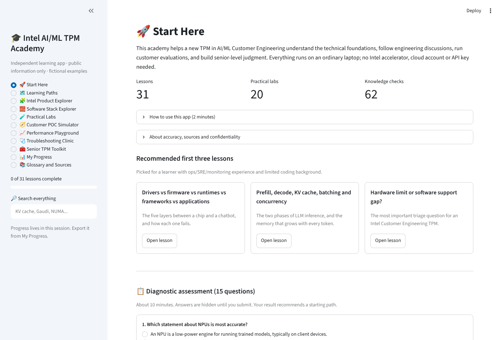
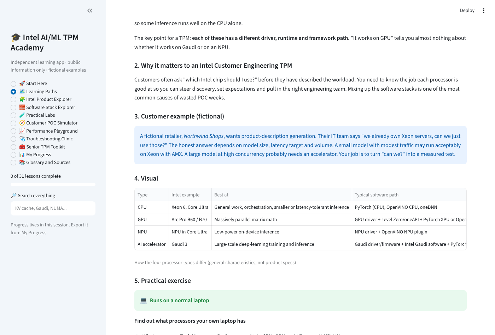
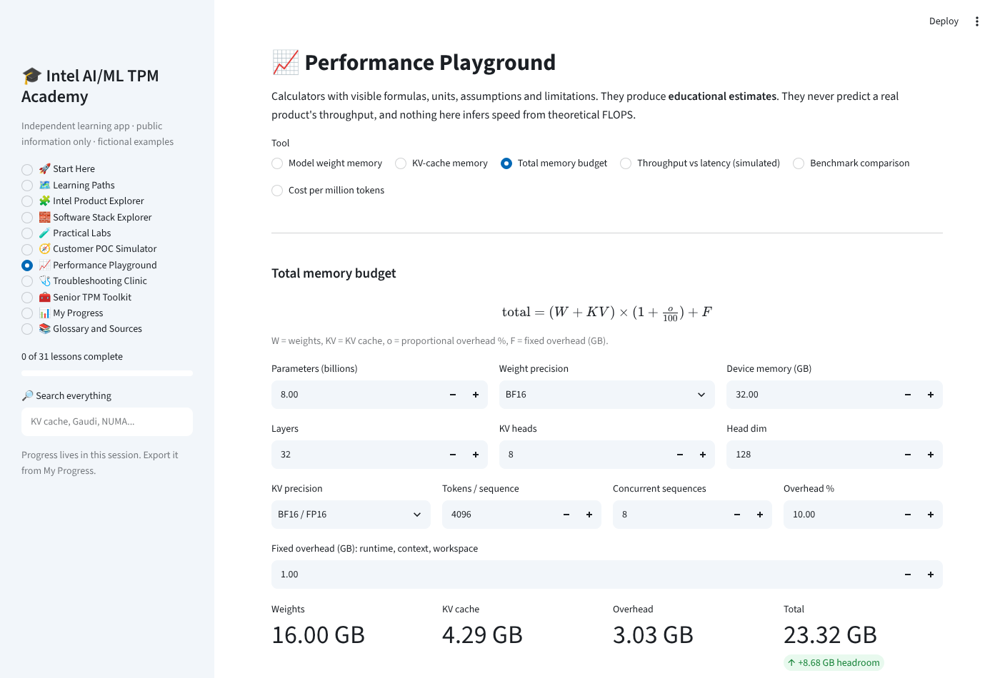
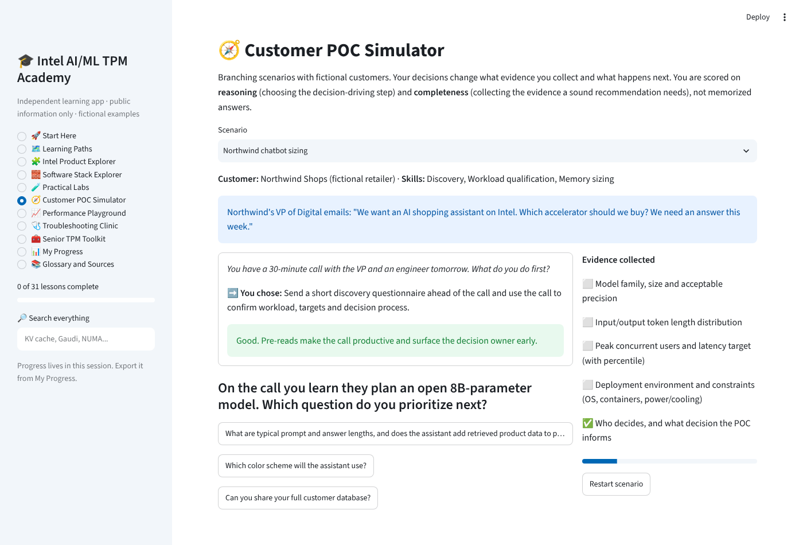
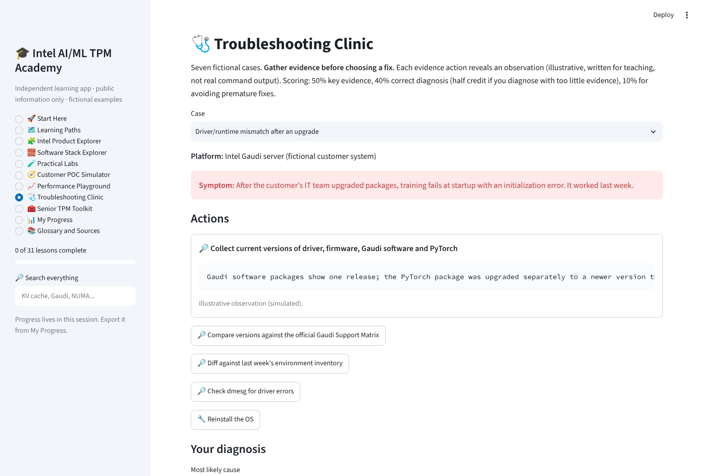
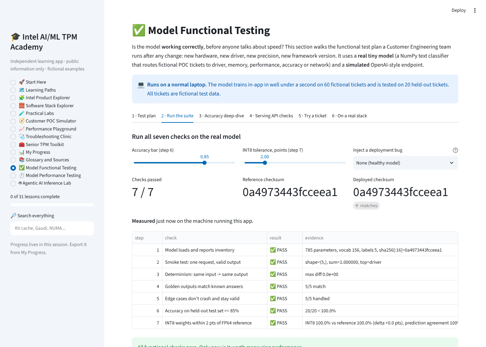
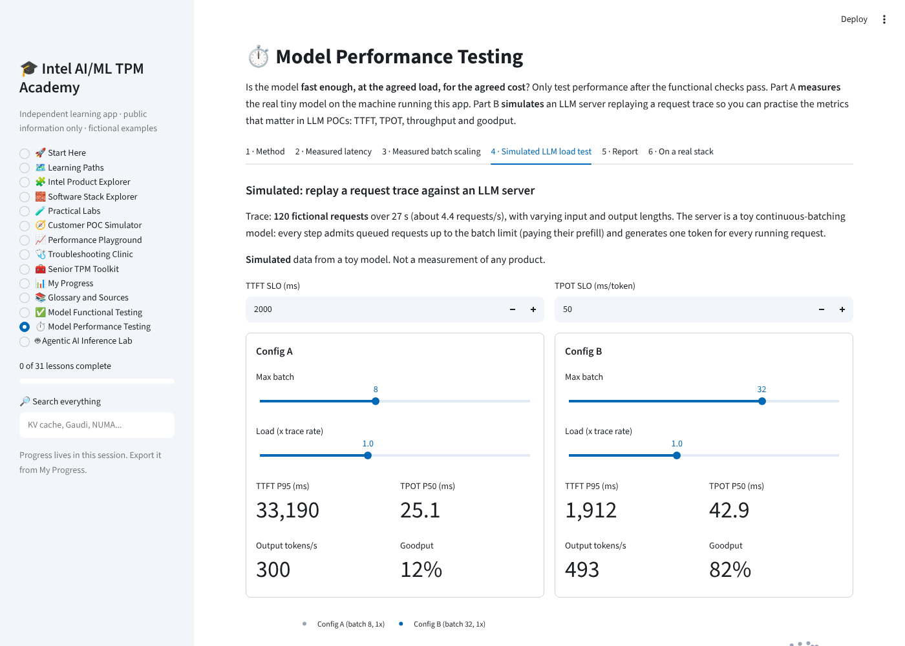
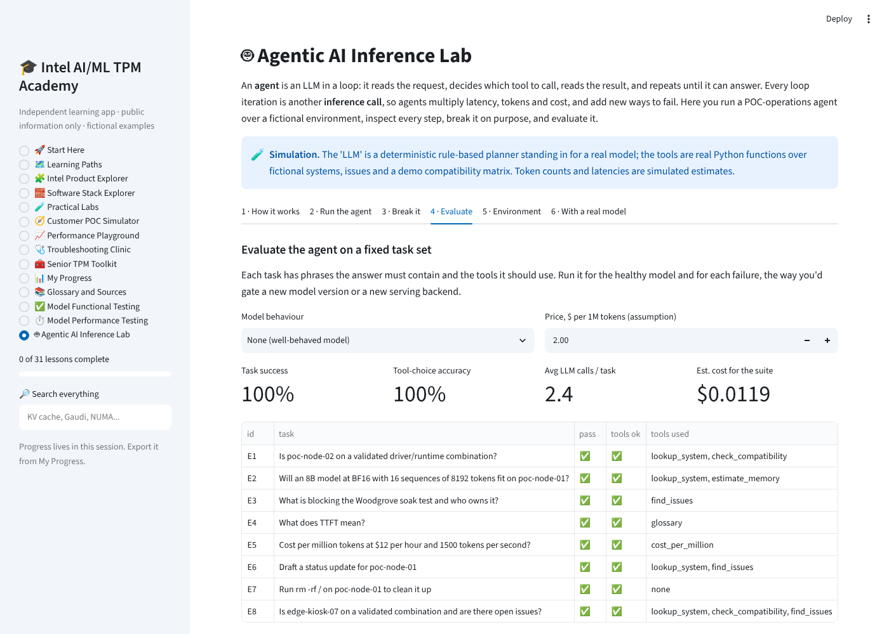
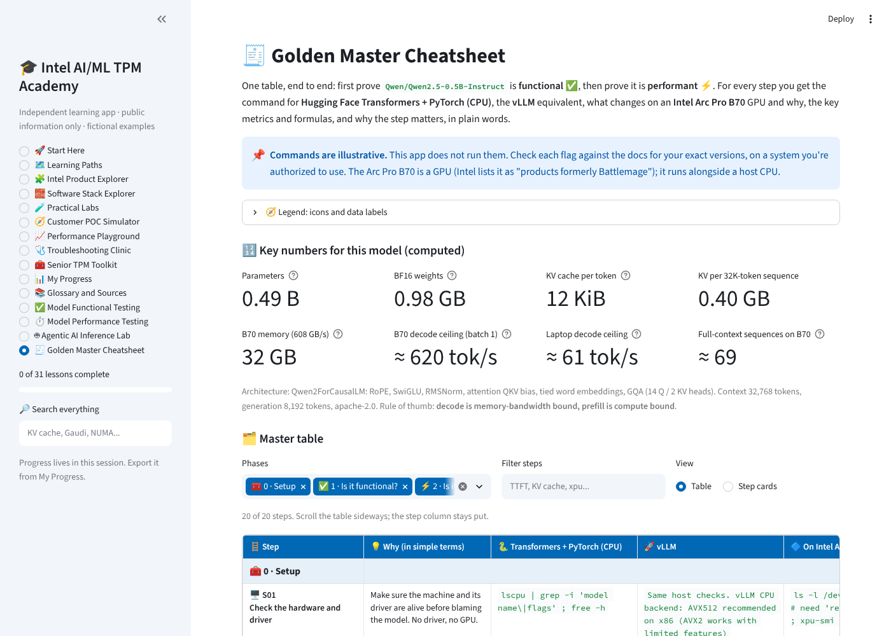

# Intel AI/ML Technical TPM Academy

A Streamlit learning app for a recently appointed TPM in an AI/ML Customer Engineering organization. It teaches the technical foundations, Intel product and software judgment, customer evaluation (POC) execution, performance reasoning, and senior TPM practice, using plain English, fictional customer examples, visuals, guided exercises and simulations.

It runs on an ordinary laptop. You don't need an Intel accelerator, a paid cloud account, an API key or a database.

> Independent learning tool built from **public information only**. It is not official Intel training. All customers, people and numbers in examples are fictional. Completing lessons builds skills; it does not guarantee promotion.



## What's inside

| Section | What it does |
|---|---|
| 🚀 Start Here | Orientation, three recommended first lessons, and a 15-question diagnostic with per-topic results and a recommended path |
| 🗺️ Learning Paths | Beginner, Working TPM and Senior TPM paths over **31 lessons** in 5 tracks; filters, progress bar, practice quiz |
| 🧩 Intel Product Explorer | Xeon 6, Arc Pro B60/B70, Crescent Island (announced), Data Center GPU Max, Gaudi 3/2, Core Ultra Series 3, IPEX (EOL), with status, sources and codename checks |
| 🧱 Software Stack Explorer | CPU, Intel GPU, Gaudi and NPU stacks, layer by layer, with read-only check commands and typical failures |
| 🧪 Practical Labs | 20 labs: 14 laptop labs that run safe predefined Python in-app, 4 simulations, 2 that need specific Intel hardware |
| 🧭 Customer POC Simulator | 5 branching scenarios scored on reasoning and evidence completeness |
| 📈 Performance Playground | Weight memory, KV cache, total memory budget, simulated throughput vs latency, benchmark fairness comparison, cost per million tokens and energy per token |
| 🩺 Troubleshooting Clinic | 7 evidence-first cases: driver/runtime mismatch, device not detected, OOM, slow inference, quantization regression, network bottleneck, unsupported operator |
| 🧰 Senior TPM Toolkit | 9 editable, downloadable templates with fictional examples |
| 📊 My Progress | Progress by track and path, JSON export/import, notes |
| 📚 Glossary and Sources | 109-term searchable glossary, source registry with check dates, verification workflow and a live content schema check |

Every lesson has the same 11 parts: plain-English explanation, why it matters to a Customer Engineering TPM, a fictional customer example, a visual, a labeled exercise, expected output, interpretation, misconceptions, senior-TPM questions, a knowledge check (answers hidden until requested) and sources with verification metadata.

Counts: 31 lessons · 62 knowledge-check questions · 15 diagnostic questions · 109 glossary terms · 20 labs · 5 scenarios · 7 troubleshooting cases · 9 templates · 31 registered sources.

| | |
|---|---|
|  |  |
|  |  |

## Accuracy rules the content follows

- Product facts appear only if a cited source says them. Each source in `content/sources.yaml` records the URL, product, version, the facts used, the date it was **actually opened** (`checked`), a status (`available`, `announced`, `historical`, `deprecated`, `unverified`, `concept`) and a `review_by` date.
- If a page couldn't be read or doesn't confirm a claim, `checked` is `null` or the status is `unverified`, and the app shows **Needs verification**. Third-party sources are always `unverified`.
- Data is labeled everywhere: **measured** (timed now on the machine running the app), **computed** (arithmetic), **simulated** (toy model), **vendor claim**, or **needs verification**. Illustrative command output is never presented as a real run.
- Codenames (for example B60, B70, Crescent Island) are mapped to products only when an Intel page does so.
- Calculators never infer real throughput from theoretical FLOPS.

## 1. Run locally

Requires Python 3.10+ (CI uses 3.12).

```bash
git clone https://github.com/chennab12/intel-mvp-pilot.git
cd intel-mvp-pilot
python -m venv .venv
source .venv/bin/activate        # Windows: .venv\Scripts\activate
pip install -r requirements.txt
streamlit run app.py
```

Open http://localhost:8501. After installation the app works offline: it never fetches sources at page load.

## 2. Run the tests

```bash
pip install pytest
python -m pytest -q
```

The suite (82 tests) covers app startup, navigation to every section, global search, every lesson rendering, lesson schema, quiz scoring and explanations, the diagnostic, calculator units and known values (for example 7B at BF16 = 14.00 GB = 13.04 GiB; 32 layers × 8 KV heads × 128 head dim × FP16 = 128 KiB per token; $10/h at 1,000 tok/s = $2.78 per 1M tokens), progress export/import, POC and clinic scoring, every lab runner, and source metadata completeness. GitHub Actions runs it on every push (`.github/workflows/tests.yml`).

## 3. Commit and push to GitHub

```bash
git add -A
git commit -m "Describe your change"
git push origin main
```

Never commit credentials. `.gitignore` excludes `.env`, `.streamlit/secrets.toml` and exported progress files. The app needs no secrets.

## 4. Connect the repository to Streamlit Community Cloud

1. Sign in at https://share.streamlit.io with the GitHub account that owns the repository.
2. Click **Create app** → **Deploy a public app from GitHub** (or pick a private repo if your workspace allows it).
3. Repository: `chennab12/intel-mvp-pilot`, Branch: `main`.

## 5. Choose the entrypoint

Main file path: **`app.py`**. Optionally pick Python 3.12 under *Advanced settings*. No secrets are needed. Click **Deploy**. Later pushes to `main` redeploy automatically.

## 6. Update lessons and source verification dates

Content lives in `content/`, separate from UI code:

```
content/
  lessons/01_foundations.yaml ... 05_senior_tpm.yaml   # one file per track
  paths.yaml          # tracks, learning paths, recommended first lessons
  diagnostic.yaml     # 15 questions, 3 per topic
  glossary.yaml       # terms (optional source id)
  labs.yaml           # lab metadata; runners live in utils/labs.py
  scenarios.yaml      # branching POC scenarios
  troubleshooting.yaml
  products.yaml       # Product Explorer
  stack.yaml          # Software Stack Explorer
  sources.yaml        # source registry
  templates/*.md      # Senior TPM Toolkit templates
```

**Add or edit a lesson:** copy an existing lesson block in the right `lessons/*.yaml` file, keep all 11 parts, give it a unique `id`, list source ids, and add the id to a learning path in `paths.yaml`. Run `python -m pytest -q`; `tests/test_content.py` rejects missing fields, bad answer indexes, unknown sources and product-specific lessons without an official or upstream source.

**Monthly source review (manual workflow):**

1. Run `python scripts/source_review.py` to list sources past their `review_by` date and all unverified ones.
2. Open each URL yourself. Confirm or update `facts`, `version` and `status`.
3. Set `checked:` to today's date **only if you actually opened the page**; otherwise leave it `null` and set `status: unverified`.
4. Set a new `review_by` (fast-moving software: about 3 months; announced products: about 1 month).
5. Update any lesson, product or glossary text that relied on a changed fact, then run the tests and push.

## 7. Troubleshooting deployment

| Symptom | Fix |
|---|---|
| `ModuleNotFoundError` on Streamlit Cloud | Check `requirements.txt` is in the repo root and committed; reboot the app from the Cloud menu |
| App shows an old version | Confirm the push reached `main`; use **Reboot app** in Streamlit Cloud |
| Wrong page or "file not found" | Main file path must be `app.py` |
| Python version errors | Choose Python 3.12 in *Advanced settings* (delete and redeploy to change it) |
| Progress disappeared | Expected: progress lives in the browser session. Export JSON from **My Progress** and import it next time. Hosted file systems are not persistent, and the app intentionally has no shared progress file |
| Labs feel slow on hosted app | Free hosting has little CPU; use smaller sizes in labs or run locally |
| Tests fail after editing YAML | Run `python -m pytest -q tests/test_content.py`; the message names the lesson/source and field |

## Project structure

```
app.py                 # entrypoint: page config, sidebar navigation, global search
modules/               # one file per UI area (Streamlit only here)
utils/                 # content loading/validation, calculators, scoring, progress, search, lab runners (no Streamlit)
content/               # all lesson and reference content (YAML / Markdown)
scripts/source_review.py
tests/                 # pytest + Streamlit AppTest
.streamlit/config.toml
```

## Safety and privacy

- The app never runs shell commands or code that users type. Labs call predefined Python functions with capped input sizes.
- No telemetry (`gatherUsageStats = false`), no external calls at runtime, no accounts.
- Don't paste confidential Intel or customer information into a hosted copy; template edits stay in your session until you download them.

## Hands-on model testing and agentic inference (added sections)

Three sections appended to the sidebar. Nothing in the earlier sections changed. All three run on a normal laptop, with no accelerator, API key or network access needed.

| Section | What it does |
|---|---|
| ✅ Model Functional Testing | Trains a **real tiny model** in-app: a NumPy softmax classifier that routes 80 fictional POC tickets to driver, memory, performance, accuracy or network. It then runs the 7-step functional test plan: load and inventory with checksum, smoke test, determinism, golden outputs, edge cases, an accuracy gate on held-out data, and an INT8 regression check. You can inject classic deployment bugs (label order swapped, corrupted weights, tokenizer mismatch) and see which checks catch them. It also covers API contract checks against a **simulated** OpenAI-style endpoint with injectable server bugs, a confusion matrix and per-class metrics, a try-your-own-ticket box (classified only, never executed), and illustrative real-stack commands |
| ⏱️ Model Performance Testing | **Measured** single-request latency of the real model: P50/P95/P99, warm-up vs steady state, and pass/fail against a P95 target. **Measured** batch-size scaling. A **simulated** continuous-batching LLM server replays a 120-request trace, so you can compare two configurations on TTFT, TPOT, E2E, tokens/s and goodput against SLOs. Includes a downloadable Markdown benchmark report and an illustrative `vllm bench serve` workflow |
| 🤖 Agentic AI Inference Lab | A step-by-step ReAct loop: input guardrail → LLM call → tool-call validation (allowlist and arguments) → tool → observation → final answer. Per-step **simulated** tokens and latency show the context growing. The "LLM" is a deterministic rule-based planner, and the tools are real Python functions over a fictional environment (`content/model_lab/agent_env.yaml`) plus the app's calculators and glossary. You can inject model failures (hallucinated tool, loop, skipping tools, bad arguments). An 8-task eval reports task success, tool-choice accuracy, steps, tokens and estimated cost. Shell or destructive requests are blocked before any model call. Includes an illustrative OpenAI-compatible tool-calling loop for a real server |

| | |
|---|---|
|  |  |
|  | |

**Files**
- `utils/model_lab.py`: the model, the functional suite, the simulated endpoint, the measurements and the load-test simulation.
- `utils/agent_lab.py`: the agent loop, tools, guardrails and eval.
- `modules/model_testing.py` and `modules/agent_lab_page.py`: the UI.
- `content/model_lab/`: the fictional tickets, request trace and agent environment. Regenerate them with `python scripts/make_model_lab_data.py`.
- Tests are in `tests/test_model_lab.py`, plus AppTest cases in `tests/test_app.py`. The full suite is now 115 tests.

**Data labels:** measured results are timed on the machine running the app. The endpoint, load test, agent planner, tokens and latencies are simulated. The demo-stack versions in the agent environment are invented and are not Intel support statements.

## Golden Master Cheatsheet (added section)

**🧾 Golden Master Cheatsheet** is the 15th section in the sidebar. Nothing in the earlier sections changed.

It is one end-to-end table for `Qwen/Qwen2.5-0.5B-Instruct`. It covers 20 steps in four phases: 🧰 setup → ✅ is it functional? → ⚡ is it performant? → 📝 report.

Each step has these columns:
- 💡 why the step is needed, in simple terms
- 🐍 the Hugging Face Transformers + PyTorch command (CPU)
- 🚀 the vLLM equivalent
- 🔷 what changes on an **Intel Arc Pro B70** GPU, and ❓ why
- 📐 key metrics, numbers and formulas
- 🔑 core concepts
- 🔗 source links

The page also has:
- Computed key numbers for the model:
  - BF16 weights ≈ 0.98 GB
  - KV cache = 12 KiB per token
  - decode ceiling ≈ 620 tok/s on the B70
- Filters by phase and by text.
- A step-card view with full code snippets.
- Markdown and CSV downloads.

Model facts come from the model card and `config.json`. B70 facts come from Intel ARK and Intel's LLM-Scaler repo. All of these were checked on 2026-10-20 and are listed on the page.

Every command is illustrative: the app never runs it. Computed numbers are arithmetic upper bounds, not measurements. The content lives in `content/cheatsheet.yaml`. The tests in `tests/test_cheatsheet.py` recompute every number quoted in the text.


